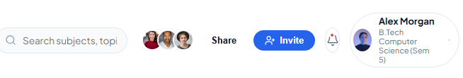

# TrackMyClass 🎓

> Smart College Attendance Tracker with What-If Bunk Simulator, Subject-Wise Tracking, Daily Lecture Notes & Homework Manager.



## ✨ Features

- **Subject-Wise Attendance Tracking**: Track individual classes and overall attendance automatically.
- **75% Regulatory Alert**: Instant reminder when any subject drops below 75%, calculating exact consecutive classes needed to recover.
- **What-If Absent Simulator (Bunk Calculator)**:
  - Select *Today*, *Tomorrow*, or any *Custom Date*.
  - Calculates percentage drops and tells whether it is **Safe** or **Critical** to bunk.
- **Daily Period Log with Notes**:
  - Record topics covered in class.
  - Track homework assignments with completion checkboxes.
- **Timetable & Holiday Management**:
  - Weekly schedule editor (Monday - Saturday).
  - Off-days, college fests, and holiday tracker.
- **Aesthetic Rounded Modern Design**: Light-themed checklist logo, spacious profile capsule, full-width search, and quick metrics overview.
- **Local Persistence**: Saves your data in browser `localStorage`.

## 🛠️ Tech Stack

- **React.js 18**
- **Vite**
- **Lucide Icons**
- **Vanilla CSS3**

## 🚀 Getting Started

### 1. Clone the repository
```bash
git clone https://github.com/sourav-gupta45/TrackMyClass.git
cd TrackMyClass
```

### 2. Install dependencies
```bash
npm install
```

### 3. Start Development Server
```bash
npm run dev
```

### 4. Build for Production
```bash
npm run build
```

## 📄 License
MIT
